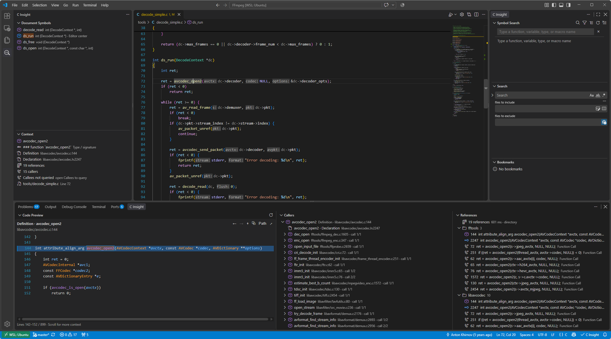
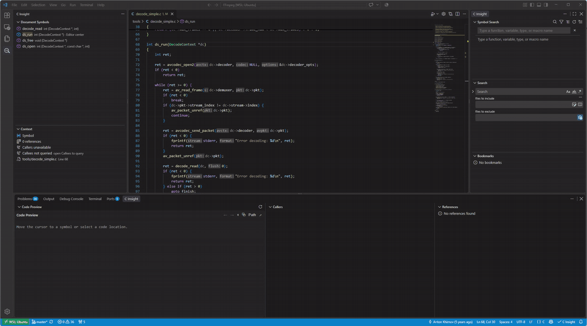
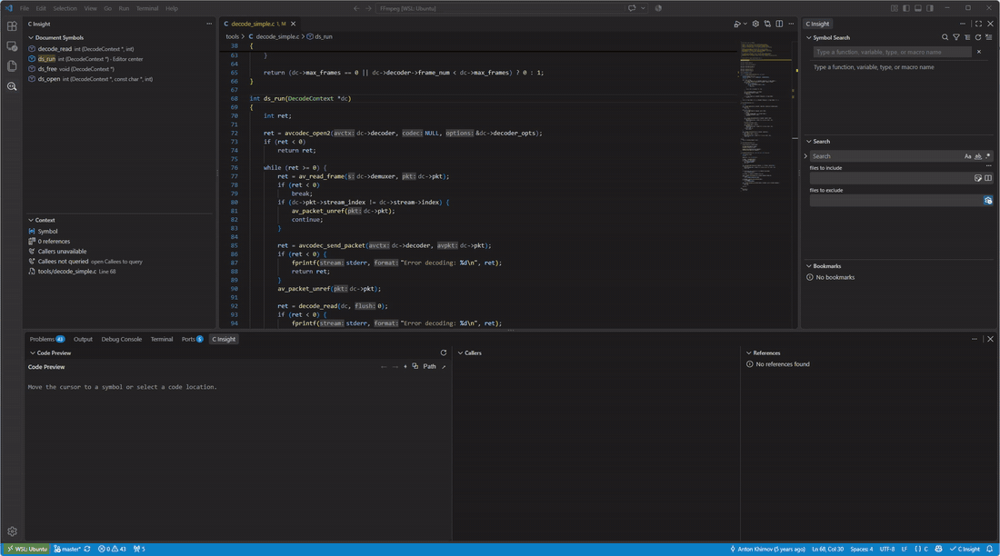

# C Insight

[](https://github.com/H9elix/c-insight/actions/workflows/ci.yml) [](https://github.com/H9elix/c-insight/releases/latest) [](LICENSE)

C Insight is a Source Insight-style C/C++ code-browsing extension for VS Code. It keeps definitions, source previews, references, callers, callees, symbols, and project relationships visible together, so you can investigate code without repeatedly replacing the file and position in the main editor.

**[阅读简体中文 README](README.zh-CN.md)** · [English user guide](docs/user/user-guide.en.md) · [中文用户手册](docs/user/user-guide.zh-CN.md) · [Latest release](https://github.com/H9elix/c-insight/releases/latest)

C Insight delegates semantic analysis to a managed `clangd` process by default, or to the installed Microsoft C/C++ language service (cpptools) when explicitly selected. It is a navigation and visualization layer: it does not compile the project, replace the build system, or create `compile_commands.json` for you.



## Why C Insight?

Since `0.22.22`, result views use a shared Webview tree: single-click previews, double-click opens the editor without expanding or collapsing, and disclosure arrows control branches independently. The same interaction covers Callers, Callees, and the other result views. See the [release notes](docs/releases/v0.22.22.md) and [interaction and maintenance guide](docs/development/custom-result-trees.zh-CN.md).

VS Code already provides commands such as Go to Definition and Find All References. C Insight turns those individual queries into a persistent browsing workspace: the editor remains available for the code you are reading while related definitions, exact call sites, references, and source snippets stay visible in dedicated views.

| While reading code | C Insight keeps available |
| --- | --- |
| Inspect a symbol without losing the current editor position | A shared Code Preview with semantic coloring and definition preference |
| Understand where and how a symbol is used | Classified, grouped, searchable, and pageable References |
| Follow control flow | Occurrence-based Callers and Callees with exact call-site locations |
| Explore structure | Document Symbols, workspace Symbol Search, Type Hierarchy, and Include Hierarchy |
| See relationships beyond one tree | Call, type, and file Relationship Graphs |
| Return to earlier investigations | Preview history, navigation history, bookmarks, pinning, and workspace-session restore |

## Core workflow

### Preview without losing your place

Move the editor cursor deliberately onto a C/C++ symbol. Context and Code Preview update automatically, while expensive References and first-level call details are staged until the cursor remains stable. Moving within the same identifier, typing, or landing on a symbol-free position does not repeatedly discard or rerun the current investigation.

Single-click any ordinary source result to show its exact location in Code Preview. Activate the same result again within the configured double-activation interval to open it in the editor. Code Preview buffers source on both sides before reveal and prefetches near loaded edges for immediate scrolling. An explicit result selection, wheel gesture, or pointer interaction remains stable through delayed context details and definition upgrades until you deliberately move the editor cursor or run an explicit refresh.


### Inspect every call occurrence

Callers and Callees show every returned call site directly beneath its semantic parent. Repeated calls remain separate navigable rows, while only the earliest occurrence of a semantic relation expands the next level. Selecting an occurrence previews the calling line rather than merely jumping to the caller's definition.

When the selected spelling is a macro that expands to a function, Callers keeps the macro identity and lists only uses of that exact macro instead of silently switching to every caller of the expanded function. This works both on a macro use and on its `#define` name. The Callers title bar and macro-root context menu then offer **Show Expanded Function Callers** when you deliberately want the Provider's expanded target instead; from a definition, that target is resolved lazily through an actual use.



### Explore relationship graphs

Open a Call Graph for a function, a Type Graph for a C++ class or struct, or a File Graph for the active source/header. Expand only the relations you need, search loaded nodes, preview a selection, collapse branches, add bookmarks, and export the loaded graph as Text, JSON, or Mermaid.



## What is included?

| Area | Main capabilities |
| --- | --- |
| Context and Code Preview | Symbol identity, signature, definition/declaration evidence, semantic source coloring, buffered incremental scrolling, stable asynchronous updates, Back/Forward, locking, copy, and editor navigation |
| References Explorer | Definition/declaration/call/read/write/address classification, file/directory/function/type grouping, scope and evidence filters, lazy snippets, paging, pinning, and export |
| Call Hierarchy | Exact incoming/outgoing call occurrences, lazy multi-level expansion, recursion handling, loaded-tree search, bounded path search, pinning, session restoration, and export |
| Type and Include Hierarchy | C++ supertypes/subtypes plus forward Includes and reverse Included By, with lazy expansion, cycle handling, search, limits, and export |
| Symbols and navigation | Document Symbols with editor-center highlighting, persistent-input workspace Symbol Search, navigation history, grouped bookmarks, and stale relocation |
| Project awareness | Compilation-database detection and selection, active command breakdown, diagnostics, clangd lifecycle and recovery, indexing progress, runtime counters, and one reliability status |

Detailed behavior, every command, and the complete configuration table are maintained in the [English user guide](docs/user/user-guide.en.md) and [Simplified Chinese user guide](docs/user/user-guide.zh-CN.md).

## Quick start

### 1. Install

Download `c-insight-<version>.vsix` and `SHA256SUMS` from the [latest GitHub Release](https://github.com/H9elix/c-insight/releases/latest), verify the checksum, and run **Extensions: Install from VSIX...** in VS Code.

### 2. Choose an analysis engine

| Engine | Role | Recommendation |
| --- | --- | --- |
| managed clangd | Default engine with the complete C Insight protocol path | Recommended; use clangd 20 or newer for full Call Hierarchy support |
| Microsoft C/C++ language service (cpptools) | Explicit opt-in through `cInsight.engine` | Useful when the project already relies on cpptools; performance and available evidence may differ |

Changing `cInsight.engine` requires **Developer: Reload Window**. C Insight reports conflicting active semantic providers before changing workspace-scoped settings.

### 3. Provide real project configuration

A `compile_commands.json` is strongly recommended. For CMake:

```sh
cmake -S . -B build -DCMAKE_EXPORT_COMPILE_COMMANDS=ON
```

C Insight searches the workspace root and common build directories, or you can run **C Insight: Select Compilation Database**. Cross-compilers, sysroots, generated headers, platform macros, and multi-platform build directories must still be described by the real build configuration; see the [cross-compilation guide](docs/user/cross-compilation.en.md).

### 4. Browse

1. Open a C or C++ folder or workspace and select the C Insight icon in the Activity Bar.
2. Put the cursor on a function, variable, type, field, or macro.
3. Expand References, Callers, or Callees, or run the matching command from the editor context menu.
4. Single-click a result to preview it; activate it again to open it in the editor.

## Interaction model

- **Single activation:** preview the exact source location without moving the editor.
- **Second activation:** open the same result in the editor.
- **Open Location:** bypass the preview step and open immediately.
- **Pin Context or References:** block automatic cursor-follow replacement for that view; explicit commands can still replace the result.
- **Pin Call Hierarchy:** Callers and Callees display separate buttons but share one synchronized pin state.
- **Lock Code Preview:** prevent editor-cursor following while preserving explicit browsing inside the preview.
- **Typing and empty positions:** retain existing navigation results instead of issuing or publishing empty automatic queries.

Hierarchy expansion is lazy and bounded. Each direction keeps its own configured depth and node budget, and cancellation preserves nodes already loaded. Hidden navigation views do not request their unrelated semantic details merely because the editor cursor moved.

## Project status and reliability

The Project Diagnostics view shows the selected engine, detected compilation database, active source-file command, include paths, definitions, diagnostics, indexing state, and runtime performance counters. The bottom status bar is the single global reliability indicator: select it to inspect missing project evidence, provider conflicts, indexing, or engine availability.

When the managed clangd process exits unexpectedly, C Insight performs bounded automatic recovery and stops a repeated crash loop before it can restart indefinitely. Existing results are retained and marked stale after relevant edits, engine restarts, configuration changes, or a new indexing pass.

## Privacy and resource use

- C Insight has no telemetry and does not upload source code.
- Source files and project metadata are read locally to provide navigation, previews, diagnostics, exports, and session restore.
- Semantic work is demand-driven, cancellable where the Provider permits it, and bounded by configurable result, depth, node, cache, and export limits.
- Installing multiple active C/C++ semantic extensions can duplicate indexing or navigation Providers; C Insight reports known conflicts and uses workspace-scoped configuration changes where possible.

See [PRIVACY.md](PRIVACY.md) for data boundaries and [SECURITY.md](SECURITY.md) for vulnerability reporting.

## Requirements and boundaries

- VS Code 1.95 or newer.
- clangd 20 or newer on `PATH`, configured through `cInsight.clangd.path`, or an explicitly selected Microsoft C/C++ language service.
- A correct compilation database or equivalent fallback flags for reliable real-project results.
- The current release supports one local workspace root.
- Static analysis cannot fully resolve every function pointer, runtime dispatch target, macro expansion, generated source, template instantiation, or inactive conditional-compilation branch.
- Reference read/write and member-instance classification remain conservative when the selected Provider does not expose enough semantic evidence.

## Documentation

- [Simplified Chinese README](README.zh-CN.md)
- [English user guide](docs/user/user-guide.en.md)
- [中文用户手册](docs/user/user-guide.zh-CN.md)
- [Cross-compilation and embedded projects](docs/user/cross-compilation.en.md)
- [交叉编译与嵌入式工程配置](docs/user/cross-compilation.zh-CN.md)
- [中文开发者手册](docs/development/developer-guide.zh-CN.md)
- [Architecture](docs/development/architecture.md)
- [Documentation index](docs/README.md)
- [Versioned release notes](docs/releases/)

## Development and maintenance

```sh
npm ci
npm run check
npm run test:e2e:xvfb
```

Open this repository in VS Code and run the `Run C Insight` launch configuration to start an Extension Development Host with `test/fixtures/basic-cpp`. Contribution requirements are in [CONTRIBUTING.md](CONTRIBUTING.md).

- Developer and maintainer: `H9elix`
- License: MIT
- Source and issues: [github.com/H9elix/c-insight](https://github.com/H9elix/c-insight)
- About the installed build: run **C Insight: About**
