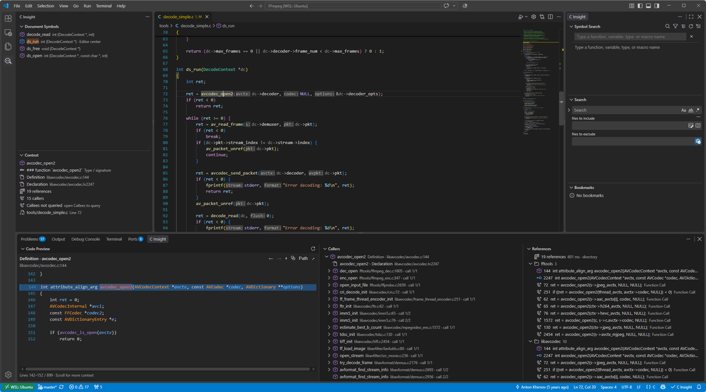
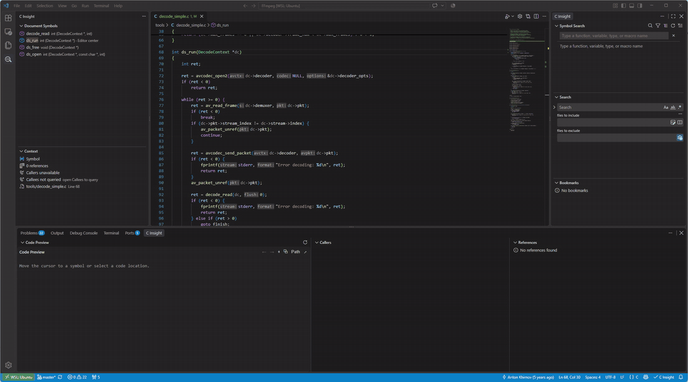
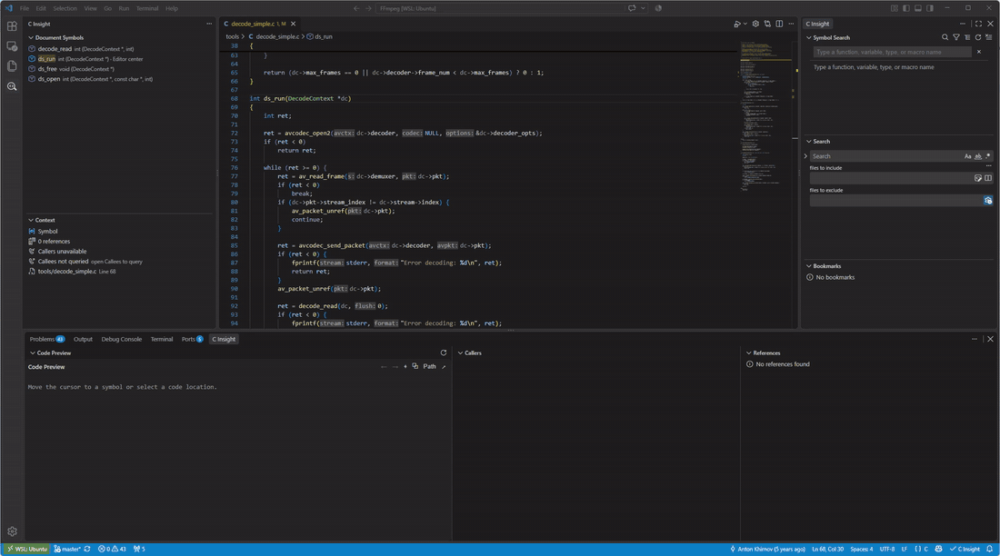

# C Insight

[](https://github.com/H9elix/c-insight/actions/workflows/ci.yml) [](https://github.com/H9elix/c-insight/releases/latest) [](LICENSE)

C Insight is a Source Insight-style C/C++ code-browsing extension for VS Code. It keeps definitions, source previews, references, callers, callees, symbols, and project relationships visible together, so you can investigate code without repeatedly replacing the file and position in the main editor.

**[阅读简体中文 README](README.zh-CN.md)** · [English user guide](docs/user/user-guide.en.md) · [中文用户手册](docs/user/user-guide.zh-CN.md) · [Latest release](https://github.com/H9elix/c-insight/releases/latest)

C Insight delegates semantic analysis to a managed `clangd` process by default, or to the installed Microsoft C/C++ language service (cpptools) when explicitly selected. It presents those results as a connected browsing workspace, using your project's compilation settings.



## Why C Insight?

VS Code already provides commands such as Go to Definition and Find All References. C Insight turns those individual queries into a persistent browsing workspace: the editor remains available for the code you are reading while related definitions, exact call sites, references, and source snippets stay visible in dedicated views.

| While reading code | C Insight keeps available |
| --- | --- |
| Inspect a symbol without losing the current editor position | A shared Code Preview with semantic coloring and definition preference |
| Understand where and how a symbol is used | Classified, grouped, searchable, and pageable References |
| Follow control flow | Occurrence-based Callers and Callees with exact call-site locations |
| Find and switch files | A searchable Project Files inventory with sorting, active-file highlighting, and independent locking |
| Fit a browsing layout to your screen | Optional combined views with drag-to-reorder panes, horizontal/vertical splitters, per-combination expansion direction, and smooth hover expansion with stable controls |
| Explore structure | Document Symbols, workspace Symbol Search, Type Hierarchy, and Include Hierarchy |
| See relationships beyond one tree | Call, type, and file Relationship Graphs |
| Return to earlier investigations | Preview history, navigation history, bookmarks, pinning, and workspace-session restore |

## Core workflow

### Preview without losing your place

Move the editor cursor deliberately onto a C/C++ symbol. Context and Code Preview update automatically, while expensive References and first-level call details are staged until the cursor remains stable. Moving within the same identifier, typing, or landing on a symbol-free position does not repeatedly discard or rerun the current investigation.

Single-click a source result to show its exact location in Code Preview; double-click it to open that location in the editor. Buffered context supports scrolling above and below the target. The preview keeps the location you selected or scrolled to until you deliberately move the editor cursor or run an explicit refresh.



### Inspect every call occurrence

Callers and Callees show every returned call site directly beneath its semantic parent. Repeated calls remain separate navigable rows, while only the earliest occurrence of a semantic relation expands the next level. Selecting an occurrence previews the calling line rather than merely jumping to the caller's definition.

When the selected spelling is a macro that expands to a function, Callers keeps the macro identity and lists only uses of that exact macro instead of silently switching to every caller of the expanded function. This works both on a macro use and on its `#define` name. The Callers title bar and macro-root context menu then offer **Show Expanded Function Callers** when you deliberately want the Provider's expanded target instead; from a definition, that target is resolved lazily through an actual use.

Callers also lists direct uses of numeric and expression macros, including references in another macro's replacement text. Each result opens the exact source location.


### Explore relationship graphs

Open a Call Graph for a function, a Type Graph for a C++ class or struct, or a File Graph for the active source/header. Expand only the relations you need, search loaded nodes, preview a selection, collapse branches, add bookmarks, and export the loaded graph as Text, JSON, or Mermaid.



## What is included?

### Fifteen independent views

Run **C Insight: Open View…** to find these views by name or purpose. Each name links to its usage instructions.

| No. | View | What you can do |
| --- | --- | --- |
| 1 | [Context](docs/user/user-guide.en.md#view-context) | Inspect the current symbol, signature, definition/declaration links and queried relationship counts |
| 2 | [Code Preview](docs/user/user-guide.en.md#view-preview) | Read source without moving the editor, follow definitions, scroll buffered context and revisit preview history |
| 3 | [References](docs/user/user-guide.en.md#view-references) | Browse exact uses with classification, grouping, search, scope/evidence filters, paging and export |
| 4 | [Callers](docs/user/user-guide.en.md#view-callers) | Inspect every incoming occurrence, follow caller chains, retain macro-use scope and optionally classify member instances |
| 5 | [Callees](docs/user/user-guide.en.md#view-callees) | Inspect outgoing calls and their exact source locations, then expand deeper |
| 6 | [Supertypes](docs/user/user-guide.en.md#view-supertypes) | Use clangd to follow C++ base types and inheritance paths |
| 7 | [Subtypes](docs/user/user-guide.en.md#view-subtypes) | Use clangd to explore derived types and search loaded relationships |
| 8 | [Includes](docs/user/user-guide.en.md#view-includes) | Follow included files and preview the #include lines establishing each relation |
| 9 | [Included By](docs/user/user-guide.en.md#view-included-by) | Find workspace files including the selected file, with an on-demand reverse index |
| 10 | [Navigation History](docs/user/user-guide.en.md#view-history) | Return to explicit browsing locations, filter by source and restore previews |
| 11 | [Bookmarks](docs/user/user-guide.en.md#view-bookmarks) | Save and group important locations, search/sort, import/export and relocate after edits |
| 12 | [Symbol Search](docs/user/user-guide.en.md#view-symbol-search) | Search workspace symbols from a persistent input with type filters and grouping |
| 13 | [Document Symbols](docs/user/user-guide.en.md#view-document-symbols) | Browse the active hierarchy, filter collapsed members, sort siblings and highlight the editor-center symbol |
| 14 | [Project Files](docs/user/user-guide.en.md#view-project-files) | Search/sort multi-root files, center the active file and independently lock automatic filter/scroll following |
| 15 | [Project Diagnostics](docs/user/user-guide.en.md#view-diagnostics) | Inspect the engine, compilation database, active command, diagnostics and runtime counters; copy/export reports |

### Combined views: a reusable browsing layout

Combined views place the C Insight features you need inside one native view: for example, **Code Preview | Callers | References** across the bottom panel. Save up to four named combinations, arrange panes horizontally or vertically, drag titles to reorder, resize with splitters, and collapse unused panes.

VS Code already supports moving, grouping and manually resizing views. Combined views build on those [native layout capabilities](https://code.visualstudio.com/docs/configure/custom-layout#_drag-and-drop-views-and-panels) with code-reading conveniences inside the combination:

- **Reading space follows your pointer:** hover enlarges the current content pane and leaving restores proportions. Forward expansion preserves leading text edges; entering titles or controls pauses resizing.
- **Manage a browsing setup together:** move the entire combination to a panel or side bar. User settings preserve its name, internal order, direction and proportions across projects.
- **Reuse features across setups:** combinations share feature results and pins while tree panes retain local filters, expansion and scrolling. Presentation copies do not create another analysis engine.

Independent views remain available. Combinations contain only the fifteen C Insight roles; Relationship Graph stays in an editor tab. See [combined-view usage and settings examples](docs/user/user-guide.en.md#combined-views).

### Other browsing tools

Relationship Graph connects calls, types and files on one canvas. A single reliability status helps assess completeness, and workspace-session restore resumes a previous investigation alongside the independent views.

Detailed behavior, every command, and the complete configuration table are maintained in the [English user guide](docs/user/user-guide.en.md) and [Simplified Chinese user guide](docs/user/user-guide.zh-CN.md).

## Quick start

### 1. Install

Download `c-insight-<version>.vsix` and `SHA256SUMS` from the [latest GitHub Release](https://github.com/H9elix/c-insight/releases/latest), verify the checksum, and run **Extensions: Install from VSIX...** in VS Code.

### 2. Choose an analysis engine

| Engine | Role | Recommendation |
| --- | --- | --- |
| managed clangd | Default engine with the complete C Insight protocol path | Recommended; use clangd 20 or newer for full Call Hierarchy support |
| Microsoft C/C++ language service (cpptools) | Explicit opt-in through `cInsight.engine` | Useful when the project already relies on cpptools; performance and available evidence may differ |

Changing `cInsight.engine` requires **Developer: Reload Window**. C Insight reports conflicting active semantic providers before changing workspace-scoped settings.

### 3. Provide real project configuration

A `compile_commands.json` is strongly recommended. For CMake:

```sh
cmake -S . -B build -DCMAKE_EXPORT_COMPILE_COMMANDS=ON
```

C Insight searches the workspace root and common build directories, or you can run **C Insight: Select Compilation Database**. Cross-compilers, sysroots, generated headers, platform macros, and multi-platform build directories must still be described by the real build configuration; see the [cross-compilation guide](docs/user/cross-compilation.en.md).

### 4. Browse

1. Open a C or C++ folder or workspace. Run **C Insight: Open View…** from the Command Palette or the C/C++ editor context menu to find all 15 independent views, open an existing combined view, or create/manage combinations. Search by view name or purpose; both localized and English names are supported.
2. Put the cursor on a function, variable, type, field, or macro.
3. Open References, Callers, or Callees. Explicit definition, reference, call and type queries are grouped under **C Insight: Symbol Navigation** in the editor context menu; bookmarks, includes and relationship graphs remain top-level C Insight actions.
4. Single-click a result to preview it; activate it again to open it in the editor.

The first time a C Insight pane becomes visible, a one-time tip links to **Open View…**. Selecting an independent view opens that native pane even if the same feature also appears in a combination. Opening the view list alone does not query the analysis engine or change your layout.

## Interaction model

- **Single activation:** preview the exact source location without moving the editor.
- **Second activation:** open the same result in the editor.
- **Open Location:** bypass the preview step and open immediately.
- **Pin Context or References:** block automatic cursor-follow replacement for that view; explicit commands can still replace the result.
- **Pin Call Hierarchy:** Callers and Callees display separate buttons but share one synchronized pin state.
- **Lock Code Preview:** prevent editor-cursor following while preserving explicit browsing inside the preview.
- **Typing and empty positions:** retain existing navigation results instead of issuing or publishing empty automatic queries.

Hierarchy expansion is lazy and bounded. Each direction keeps its own configured depth and node budget, and cancellation preserves nodes already loaded. Hidden navigation views do not request their unrelated semantic details merely because the editor cursor moved.

## Project status and reliability

The Project Diagnostics view shows the selected engine, detected compilation database, active source-file command, include paths, definitions, diagnostics, indexing state, and runtime performance counters. The bottom status bar is the single global reliability indicator: select it to inspect missing project evidence, provider conflicts, indexing, or engine availability.

When the managed clangd process exits unexpectedly, C Insight performs bounded automatic recovery and stops a repeated crash loop before it can restart indefinitely. Existing results are retained and marked stale after relevant edits, engine restarts, configuration changes, or a new indexing pass.

## Privacy and resource use

- C Insight has no telemetry and does not upload source code.
- Source files and project metadata are read locally to provide navigation, previews, diagnostics, exports, and session restore.
- Semantic work is demand-driven, cancellable where the Provider permits it, and bounded by configurable result, depth, node, cache, and export limits.
- Installing multiple active C/C++ semantic extensions can duplicate indexing or navigation Providers; C Insight reports known conflicts and uses workspace-scoped configuration changes where possible.

See [PRIVACY.md](PRIVACY.md) for data boundaries and [SECURITY.md](SECURITY.md) for vulnerability reporting.

## Requirements and boundaries

- VS Code 1.95 or newer.
- clangd 20 or newer on `PATH`, configured through `cInsight.clangd.path`, or an explicitly selected Microsoft C/C++ language service.
- A correct compilation database or equivalent fallback flags for reliable real-project results.
- Local folders, multi-root workspaces, WSL, SSH, and containers are supported; install C Insight and its analysis engine in the environment hosting the source files.
- Static analysis cannot fully resolve every function pointer, runtime dispatch target, macro expansion, generated source, template instantiation, or inactive conditional-compilation branch.
- Reference read/write and member-instance classification remain conservative when the selected Provider does not expose enough semantic evidence.

## Documentation

- [Simplified Chinese README](README.zh-CN.md)
- [English user guide](docs/user/user-guide.en.md)
- [中文用户手册](docs/user/user-guide.zh-CN.md)
- [Cross-compilation and embedded projects](docs/user/cross-compilation.en.md)
- [交叉编译与嵌入式工程配置](docs/user/cross-compilation.zh-CN.md)
- [中文开发者手册](docs/development/developer-guide.zh-CN.md)
- [Architecture](docs/development/architecture.md)
- [Regression testing guide and historical cases (中文)](docs/validation/regression-testing-guide.zh-CN.md)
- [Documentation index](docs/README.md)
- [Versioned release notes](docs/releases/)

## Development and maintenance

```sh
npm ci
npm run check
npm run test:e2e:xvfb
```

Open this repository in VS Code and run the `Run C Insight` launch configuration to start an Extension Development Host with `test/fixtures/basic-cpp`. Contribution requirements are in [CONTRIBUTING.md](CONTRIBUTING.md).

- Developer and maintainer: `H9elix`
- License: MIT
- Source and issues: [github.com/H9elix/c-insight](https://github.com/H9elix/c-insight)
- About the installed build: run **C Insight: About**
