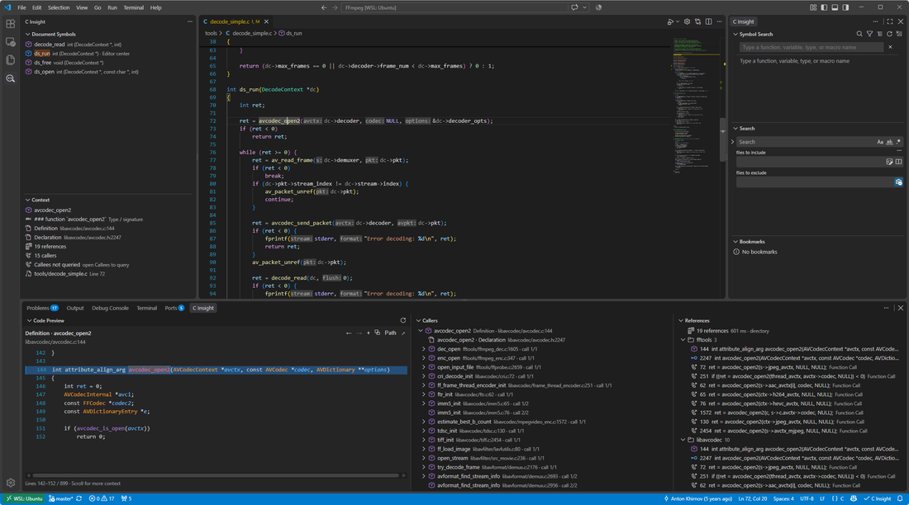
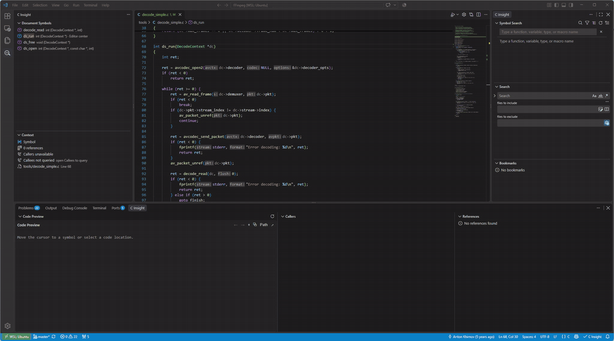
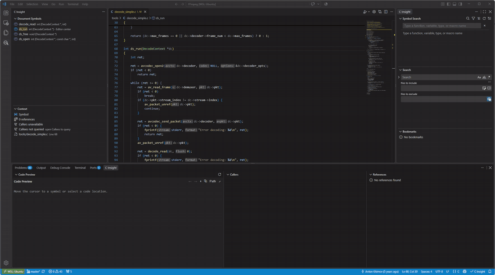
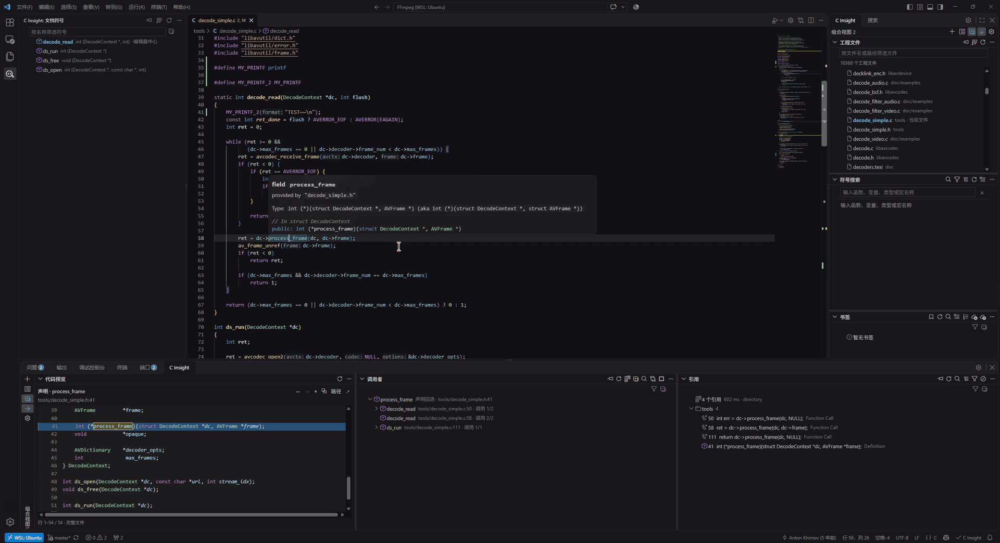

# C Insight

[](https://github.com/H9elix/c-insight/actions/workflows/ci.yml) [](https://github.com/H9elix/c-insight/releases/latest) [](LICENSE)

C Insight 是一款在 VS Code 中提供 Source Insight 风格 C/C++ 源码浏览体验的扩展。它把定义、源码预览、引用、调用者、被调用者、符号和工程关系持续显示在一起，让你在分析代码时不必反复替换主编辑器中的文件和位置。

**[Read the English README](README.md)** · [中文用户手册](docs/user/user-guide.zh-CN.md) · [English user guide](docs/user/user-guide.en.md) · [最新版本](https://github.com/H9elix/c-insight/releases/latest)

C Insight 默认把语义分析委托给自身管理的 `clangd` 进程，也可以在明确选择后使用已安装的 Microsoft C/C++ language service (cpptools)。它使用工程的编译配置，把分析结果组织成相互关联的源码浏览工作区。



## 为什么使用 C Insight？

VS Code 已经提供“转到定义”和“查找所有引用”等命令。C Insight 把这些一次性查询组织成持续可见的源码浏览工作区：主编辑器可以保留你正在阅读的代码，相关定义、准确调用位置、引用和源码片段则显示在专用窗口中。

| 阅读代码时的需求 | C Insight 持续提供的内容 |
| --- | --- |
| 查看符号但不想丢失当前编辑位置 | 带语义着色并优先显示定义的共享代码预览 |
| 理解符号在哪里以及如何被使用 | 可分类、分组、搜索和分页的引用 |
| 跟踪控制流 | 保留准确调用位置的调用者与被调用者树 |
| 查找和切换文件 | 可搜索、排序的工程文件清单，支持当前文件高亮和独立锁定 |
| 查看代码结构 | 文档符号、工作区符号搜索、类型层次和包含层次 |
| 查看超出单棵树的关系 | 调用、类型和文件关系图 |
| 回到先前的分析过程 | 预览历史、导航历史、书签、固定状态和工作区会话恢复 |

## 核心工作流程

### 不离开当前位置也能查看代码

主动把编辑器光标移动到 C/C++ 符号上，上下文和代码预览会自动更新；引用以及第一层调用详情会等光标稳定后再查询。光标在同一标识符内部移动、输入文字或者移到没有符号的位置时，不会反复丢弃或重新查询当前分析结果。

单击源码结果，在代码预览中查看准确位置；双击则在编辑器中打开。预览会缓冲目标上下文，支持向上、向下连续滚动。你选中或滚动到的位置会保持不变，直到主动移动编辑器光标或执行显式刷新。



### 查看每一个调用位置

调用者和被调用者会把语义父节点返回的每个调用位置直接显示出来。同一函数中的重复调用仍然是各自可导航的结果，只有同一语义关系中最早的调用位置负责展开下一层。选择某个调用位置时，代码预览显示的是实际调用行，而不只是调用者函数的定义。

当选中的源码拼写是一个会展开为函数的宏时，调用者会保留宏本身的身份，只列出这个宏的准确使用位置，不会静默切换为展开后函数的全部调用者；光标位于宏使用处或 `#define` 定义名上时均可获得该结果。需要查询展开目标时，可点击调用者标题栏中的**查询宏展开后函数的调用者（Show Expanded Function Callers）**按钮，或在宏根节点的右键菜单中执行同一命令；从定义处执行时，只在此刻通过实际使用位置按需解析展开目标。

调用者也支持数值宏、表达式宏，以及其他宏替换文本中的直接引用，每个结果均可定位到准确源码位置。


### 使用关系图浏览工程

可以为函数打开调用图，为 C++ 类或结构体打开类型图，也可以为活动源码或头文件打开文件图。关系图支持按需展开、搜索已加载节点、预览选中结果、折叠分支、添加书签，以及导出 Text、JSON 或 Mermaid。



## 包含哪些功能？

### 16 个独立视图

执行 **C Insight：打开视图…（Open View…）**，按名称或用途找到以下栏目。每个名称都链接到对应的使用说明。

| 序号 | 视图 | 可以做什么 |
| --- | --- | --- |
| 1 | [上下文（Context）](docs/user/user-guide.zh-CN.md#view-context) | 查看当前符号、签名、定义／声明和已查询的关系数量 |
| 2 | [代码预览（Code Preview）](docs/user/user-guide.zh-CN.md#view-preview) | 在不移动主编辑器的情况下阅读源码，继续浏览定义，滚动加载上下文并使用预览历史 |
| 3 | [引用（References）](docs/user/user-guide.zh-CN.md#view-references) | 查看准确使用位置，按类型、文件、函数或证据分组，并搜索、筛选、分页和导出 |
| 4 | [调用者（Callers）](docs/user/user-guide.zh-CN.md#view-callers) | 逐个查看调用当前符号的位置，向上展开调用链，查询宏自身使用及可选的成员实例分类 |
| 5 | [被调用者（Callees）](docs/user/user-guide.zh-CN.md#view-callees) | 查看当前函数调用了哪些函数，预览每个调用点并向下展开 |
| 6 | [父类型（Supertypes）](docs/user/user-guide.zh-CN.md#view-supertypes) | 使用 clangd 浏览 C++ 类或结构体的基类型与继承路径 |
| 7 | [子类型（Subtypes）](docs/user/user-guide.zh-CN.md#view-subtypes) | 使用 clangd 浏览派生类型，按需展开和搜索已加载关系 |
| 8 | [包含文件（Includes）](docs/user/user-guide.zh-CN.md#view-includes) | 查看源码或头文件包含的文件，并定位产生关系的 `#include` 行 |
| 9 | [被包含关系（Included By）](docs/user/user-guide.zh-CN.md#view-included-by) | 反向查找工作区内哪些文件包含当前文件，按需建立索引 |
| 10 | [导航历史（Navigation History）](docs/user/user-guide.zh-CN.md#view-history) | 返回之前显式浏览的位置，按来源筛选并恢复预览 |
| 11 | [书签（Bookmarks）](docs/user/user-guide.zh-CN.md#view-bookmarks) | 保存和分组重要位置，搜索、排序、导入／导出，并在编辑后尝试重定位 |
| 12 | [符号搜索（Symbol Search）](docs/user/user-guide.zh-CN.md#view-symbol-search) | 使用常驻输入框搜索工作区符号，按类型筛选和分组 |
| 13 | [文档符号（Document Symbols）](docs/user/user-guide.zh-CN.md#view-document-symbols) | 浏览当前文档层次，筛选折叠成员、排序，并高亮编辑器中心对应符号 |
| 14 | [工程文件（Project Files）](docs/user/user-guide.zh-CN.md#view-project-files) | 搜索和排序多根工作区文件，居中跟随活动文件，独立锁定筛选与滚动 |
| 15 | [工程诊断（Project Diagnostics）](docs/user/user-guide.zh-CN.md#view-diagnostics) | 检查分析引擎、编译数据库、活动编译命令、诊断及运行时计数，复制或导出报告 |
| 16 | [搜索与替换（Search & Replace）](docs/user/user-guide.zh-CN.md#view-text-search) | 不依赖分析引擎进行跨文件文本搜索；预览差异并确认替换 |

### 组合视图：把一套阅读布局放在一起

**组合视图（Combined View）**把所需的 C Insight 功能放进一个原生视图，例如在底部横向排列“代码预览｜调用者｜引用”。最多可保存四个命名组合；每个组合支持水平／垂直排列、拖动标题排序、拖动分隔条调尺寸，以及折叠不常用的窗格。

VS Code 本身已经支持移动、归组和手动调整视图尺寸。组合视图在这些[原生布局能力](https://code.visualstudio.com/docs/configure/custom-layout#_drag-and-drop-views-and-panels)之上，提供更适合持续阅读代码的内部布局：

- **阅读空间随鼠标调整：**悬停时扩展当前内容区，移出后恢复比例；可[按栏目设置展开占比](docs/user/user-guide.zh-CN.md#combined-hover-size)，并独立选择双向、向右／下或向左／上。未配置时，当前未折叠的末尾栏目双向，其余向右／下；进入标题或按钮区时暂停伸缩。
- **整套布局一起管理：**一个组合可整体移动到底部或侧栏，其名称、内部顺序、方向和比例保存在用户设置中，跨工程复用。
- **同一功能可出现在多套组合中：**复用同一份业务结果和固定状态，树窗格分别保留局部筛选、展开和滚动，不为显示副本建立第二个分析引擎。



原来的独立视图继续可用。组合只容纳上述 16 个 C Insight 功能；关系图仍在编辑器标签页打开。创建、管理和配置示例见[组合视图使用说明](docs/user/user-guide.zh-CN.md#combined-views)。

### 其他浏览工具

函数、类型和文件的关系图把多种关系放到一张画布中；统一可靠性状态栏帮助判断结果完整性，工作区会话恢复可接续上一次浏览。这些工具与 16 个独立视图配合使用。

详细行为、全部命令以及完整配置表位于[中文用户手册](docs/user/user-guide.zh-CN.md)和 [English user guide](docs/user/user-guide.en.md)。

## 快速开始

### 1. 安装

从[最新 GitHub Release](https://github.com/H9elix/c-insight/releases/latest) 下载 `c-insight-<version>.vsix` 和 `SHA256SUMS`，校验后在 VS Code 中运行 **扩展：从 VSIX 安装...**。

### 2. 选择分析引擎

| 引擎 | 定位 | 建议 |
| --- | --- | --- |
| 托管 clangd | 默认引擎，使用完整的 C Insight 协议路径 | 推荐；完整调用层次建议使用 clangd 20 或更高版本 |
| Microsoft C/C++ language service (cpptools) | 通过 `cInsight.engine` 明确选择后启用 | 适合已经依赖 cpptools 的工程；性能和可用证据可能与 clangd 不同 |

修改 `cInsight.engine` 后需要执行 **开发人员：重新加载窗口**。C Insight 会在更改工作区范围配置前报告已知的活动语义提供程序冲突。

### 3. 提供真实工程配置

真实工程强烈建议提供 `compile_commands.json`。使用 CMake 时可以运行：

```sh
cmake -S . -B build -DCMAKE_EXPORT_COMPILE_COMMANDS=ON
```

C Insight 会搜索工作区根目录和常见构建目录，也可以执行 **C Insight：选择编译数据库**。交叉编译器、sysroot、生成头文件、平台宏和多平台构建目录仍然必须由真实构建配置描述，具体方法见[交叉编译指南](docs/user/cross-compilation.zh-CN.md)。

### 4. 开始浏览

1. 打开 C/C++ 文件夹或工作区。在命令面板或 C/C++ 编辑器右键菜单执行 **C Insight：打开视图…（Open View…）**，查找全部 16 个独立视图、打开已有组合视图，或创建／管理组合。支持按视图名称和用途搜索，也支持英文名称。
2. 把光标放在函数、变量、类型、成员或宏上。
3. 打开引用、调用者或被调用者。
4. 单击结果进行预览，双击同一结果则在编辑器中打开。

首次实际显示 C Insight 栏目时，一次性提示会提供“打开视图…”入口。选择独立视图会直接打开该原生栏目，即使组合视图中也有同名功能。只打开选择列表不会查询分析引擎或改变布局。

## 交互规则

- **单击：**在不移动编辑器的情况下预览准确源码位置。
- **双击：**在编辑器中打开同一结果。
- **打开位置：**跳过预览步骤，立即在编辑器中打开。
- **固定上下文或引用：**阻止对应窗口被光标自动替换；显式命令仍然可以替换结果。
- **固定调用层次：**调用者和被调用者各自显示按钮，但共享同一个同步固定状态。
- **锁定代码预览：**阻止编辑器光标跟随，同时保留预览内部的显式浏览能力。
- **输入文字或移到空白位置：**保留现有导航结果，不发起或发布空的自动查询。

层次展开采用懒加载并受安全上限约束。每个方向拥有独立的深度和节点预算，取消操作会保留已经加载的节点。隐藏的导航窗口不会仅因为编辑器光标移动就查询与其相关的语义详情。

## 工程状态与可靠性

工程诊断显示所选引擎、检测到的编译数据库、活动源文件编译命令、包含路径、宏定义、诊断、索引状态和运行时性能计数器。底部状态栏是全局可靠性信息的唯一位置；选择它可以查看工程证据缺失、提供程序冲突、索引进度或引擎可用性。

托管 clangd 意外退出时，C Insight 会进行有界自动恢复，并在重复崩溃时停止重启循环。发生相关源码编辑、引擎重启、配置变化或新一轮索引时，现有结果会继续保留并标记为已过期。

## 隐私与资源占用

- C Insight 不包含遥测，也不会上传源代码。
- 源文件和工程元数据只在本地用于导航、预览、诊断、导出和会话恢复。
- 语义工作按需执行；在提供程序允许时可以取消，并受到结果数、深度、节点、缓存和导出上限约束。
- 同时启用多个 C/C++ 语义扩展可能产生重复索引或重复导航提供程序；C Insight 会报告已知冲突，并尽可能只修改工作区范围的设置。

数据边界见 [PRIVACY.md](PRIVACY.md)，漏洞报告方法见 [SECURITY.md](SECURITY.md)。

## 运行要求与能力边界

- VS Code 1.95 或更高版本。
- `PATH` 中存在 clangd 20 或更高版本，也可以通过 `cInsight.clangd.path` 配置，或者明确选择 Microsoft C/C++ language service。
- 真实工程需要正确的编译数据库或等价的回退参数，才能得到可靠结果。
- 支持本地文件夹、多根工作区、WSL、SSH 和容器；请在源码所在的环境中安装 C Insight 及其分析引擎。
- 静态分析无法完整解析所有函数指针、运行时分派目标、宏展开、生成源码、模板实例化或未激活条件编译分支。
- 当所选提供程序没有暴露足够的语义证据时，引用读写和成员实例分类会保持保守判断。

## 文档

- [English README](README.md)
- [中文用户手册](docs/user/user-guide.zh-CN.md)
- [English user guide](docs/user/user-guide.en.md)
- [交叉编译与嵌入式工程配置](docs/user/cross-compilation.zh-CN.md)
- [Cross-compilation and embedded projects](docs/user/cross-compilation.en.md)
- [中文开发者手册](docs/development/developer-guide.zh-CN.md)
- [架构说明](docs/development/architecture.md)
- [历史问题驱动测试指南与回归案例](docs/validation/regression-testing-guide.zh-CN.md)
- [文档索引](docs/README.md)
- [版本化发布说明](docs/releases/)

## 开发与维护

```sh
npm ci
npm run check
npm run test:e2e:xvfb
```

在 VS Code 中打开本仓库并运行 `Run C Insight` 启动配置，即可使用 `test/fixtures/basic-cpp` 启动扩展开发宿主。贡献要求见 [CONTRIBUTING.md](CONTRIBUTING.md)。

- 开发者和维护者：`H9elix`
- 许可证：MIT
- 源码和问题：[github.com/H9elix/c-insight](https://github.com/H9elix/c-insight)
- 查看已安装版本：运行 **C Insight：关于**
